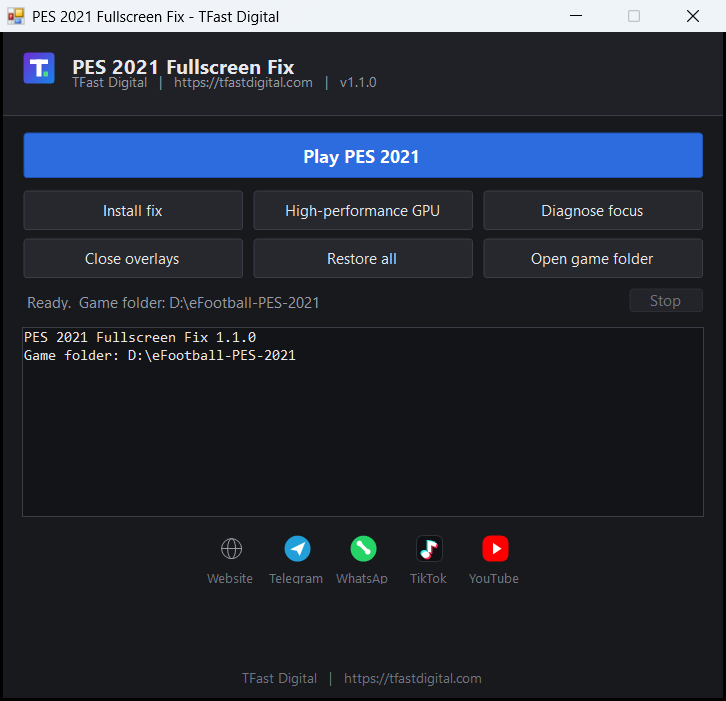

# PES 2021 Fullscreen Fix

[](https://github.com/tfastdigital6/pes2021-fullscreen-fix/actions/workflows/build.yml)
[](https://github.com/tfastdigital6/pes2021-fullscreen-fix/releases/latest)
[](https://github.com/tfastdigital6/pes2021-fullscreen-fix/releases)
[](LICENSE)
[](https://github.com/tfastdigital6/pes2021-fullscreen-fix/releases/latest)

Fixes the two things that stop **eFootball PES 2021 SEASON UPDATE** from staying fullscreen on
modern Windows: the game dropping to the taskbar, and the game running on the wrong graphics
processor.

No installer, no background services beyond an optional fullscreen watchdog, no telemetry, no
network calls except an optional update check.

**[Download the latest release](https://github.com/tfastdigital6/pes2021-fullscreen-fix/releases/latest)** ·
**[Project page](https://tfastdigital6.github.io/pes2021-fullscreen-fix/)**



---

## The problem

PES 2021 uses exclusive fullscreen. On Windows 10 and 11 that breaks in three predictable ways:

| Symptom                                    | Cause                                                                                              |
| ------------------------------------------ | -------------------------------------------------------------------------------------------------- |
| Game starts minimised, sits on the taskbar | Display scaling above 100%, or Windows "fullscreen optimisations", prevents the mode switch        |
| Game drops to the taskbar mid-session      | Another window takes the foreground; exclusive fullscreen releases the display when it loses focus |
| Game runs on the integrated GPU / stutters | Hybrid graphics laptop picks the power-saving GPU, or switches mid-session                         |

These are documented, widely reported behaviours, not faults in your install:

- Steam, [eFootball PES 2021 discussion](https://steamcommunity.com/app/1259970/discussions/0/2944747978650489229/) — "Can't play in fullscreen"
- Microsoft Q&A — "Games keep reducing to icon on fullscreen" (foreground stealing)
- Microsoft Q&A — "Games lose focus on every click — Explorer.exe / MSCTFIME UI stealing focus (Win11 24H2)"
- `ForegroundLockTimeout` documentation, `HKCU\Control Panel\Desktop`

## What the tool does

1. **Display settings** — writes Screen Mode = Full Screen at the monitor's native resolution into
   `Documents\KONAMI\eFootball PES 2021 SEASON UPDATE\settings.dat`, so you never have to open
   `Settings.exe` again.
2. **Compatibility flags** — per-user `DISABLEDXMAXIMIZEDWINDOWEDMODE` (disable fullscreen
   optimisations) and `HIGHDPIAWARE` (DPI scaling = Application) for `PES2021.exe`.
3. **GPU selection** — enumerates adapters through DXGI, classifies each as integrated, discrete or
   virtual, and pins the game to the discrete GPU. Verified afterwards against live GPU engine
   counters, so you can see which processor is really rendering.
4. **Focus protection** — raises Windows' own foreground lock (`ForegroundLockTimeout`) so background
   applications are refused when they try to take focus.
5. **Overlay control** — closes known focus-stealing overlays (ScreenRec, Xbox Game Bar, NVIDIA,
   AMD, Overwolf, RivaTuner, Fraps, Steam overlay helper) while the game runs, and re-checks so a
   self-restarting recorder is closed again.
6. **Fullscreen watchdog** — if the game is minimised involuntarily, restores and refocuses it within
   about a second. Deliberate Alt+Tab, Win key and taskbar clicks are respected.
7. **Diagnostics** — `Diagnose focus` logs every process that takes the foreground, so an unknown
   culprit can be identified on any machine.

Every change is reversible with one button. Original values are saved before anything is modified.

## Requirements

- Windows 10 or 11, 64-bit
- .NET Framework 4.x (present on every supported Windows version)
- No administrator rights for normal use. `Add Defender exclusion` needs an elevated window.

## Usage

Download `PES 2021 TFast Fix.exe` from [Releases](https://github.com/tfastdigital6/pes2021-fullscreen-fix/releases/latest)
and place it next to `PES2021.exe`, then run it.

| Button               | Action                                                                  |
| -------------------- | ----------------------------------------------------------------------- |
| Play PES 2021        | Apply the fix, start the game, keep it fullscreen. Enter does the same. |
| Install fix          | Also start the watchdog with Windows, so any shortcut works.            |
| High-performance GPU | Detect GPUs, force the discrete one, verify it.                         |
| Diagnose focus       | List the programs taking the foreground.                                |
| Close overlays       | Close overlay processes now.                                            |
| Restore all          | Undo every change, with confirmation.                                   |
| Open game folder     | Open the install folder.                                                |

Command line, for scripts:

```text
PES 2021 TFast Fix.exe -Action Play
PES 2021 TFast Fix.exe -Action Fix -InstallStartup
PES 2021 TFast Fix.exe -Action Gpu
PES 2021 TFast Fix.exe -Action Diagnose -DiagnoseSeconds 120
PES 2021 TFast Fix.exe -Action Overlays
PES 2021 TFast Fix.exe -Action Restore
PES 2021 TFast Fix.exe -Action Fix -GameDir "D:\games\PES2021"
```

The engine can also be run directly, without the GUI:

```powershell
git clone https://github.com/tfastdigital6/pes2021-fullscreen-fix.git
cd pes2021-fullscreen-fix
powershell -ExecutionPolicy Bypass -File .\src\PES2021-Fullscreen.ps1 -Action Fix
```

Run `-Action Help` for the full option list, including `-Mode Borderless`, `-GpuPreference`,
`-PreserveOverlay`, `-ExtraOverlay` and `-DefenderExclusion`.

## Update check

The application checks `docs/version.json` on [GitHub Pages](https://tfastdigital6.github.io/pes2021-fullscreen-fix/)
once per launch, in the background. If a newer version exists it shows a single line with a link to
the release. Nothing is downloaded or executed automatically, and the check is skipped when you are
offline. Section [Privacy](#privacy) covers exactly what is sent.

## Troubleshooting

| Symptom                            | Fix                                                                                                              |
| ---------------------------------- | ---------------------------------------------------------------------------------------------------------------- |
| Still drops to the taskbar         | Run `Diagnose focus`, then add the named program with `-ExtraOverlay name.exe`                                   |
| Game looks blurry                  | Set display scaling to 100%, or keep `HIGHDPIAWARE` and use native resolution                                    |
| Taskbar visible over the game      | Use Fullscreen, not `-Mode Borderless`; Windows 11 keeps the taskbar above borderless windows                    |
| Update says a newer version exists | Download it from [Releases](https://github.com/tfastdigital6/pes2021-fullscreen-fix/releases) and replace the exe |
| Something is broken                | `Restore all`, then reopen an issue with the log from `%TEMP%\PES2021Fullscreen.log`                             |

## Privacy

- No telemetry, no analytics, no crash reporting.
- The update check requests one static JSON file from GitHub Pages. GitHub receives your IP address,
  as with any web request. No identifiers, no query parameters.
- Disable it with `-NoUpdateCheck`, or by blocking `tfastdigital6.github.io`.
- Nothing is uploaded. Logs stay in `%TEMP%`.

## Project layout

```text
src/PES2021-Fullscreen.ps1      fix engine (PowerShell 5.1)
src/gui/TfastRunnerGui.cs       Windows Forms front end (C# 5)
build/build-gui.ps1             compiles the GUI, embeds the engine as a resource
build/make-icon.ps1             generates the application icon
launchers/                      double-click .cmd wrappers
docs/                           GitHub Pages site and update feed
.github/workflows/              CI: build, verify, publish release and Pages
```

The GUI embeds `PES2021-Fullscreen.ps1` as a resource and extracts it to
`%LOCALAPPDATA%\TFastDigital\` at run time, so the shipped exe is a single file.

## Building

```powershell
git clone https://github.com/tfastdigital6/pes2021-fullscreen-fix.git
cd pes2021-fullscreen-fix
powershell -ExecutionPolicy Bypass -File .\build\build-gui.ps1
```

Output: `build/PES 2021 TFast Fix.exe`. The script prints the embedded version metadata so a
branding or version mistake fails loudly instead of shipping.

## Contributing

Bug reports and pull requests are welcome. See [CONTRIBUTING.md](CONTRIBUTING.md) for the build
steps, coding conventions and release procedure, and [SECURITY.md](SECURITY.md) for reporting
vulnerabilities privately.

## Credits and licence

Built by [TFast Digital](https://tfastdigital.com).

- Telegram: https://t.me/tfasthub
- WhatsApp: https://whatsapp.com/channel/0029VaAYznPK5cDIXJa9nW1a
- TikTok: https://www.tiktok.com/@tfasthub
- YouTube: https://www.youtube.com/@TfastDigital

Released under the [MIT Licence](LICENSE).

Not affiliated with Konami. eFootball PES 2021 and its assets belong to Konami Digital
Entertainment. This project contains no game files and distributes no copyrighted material.
